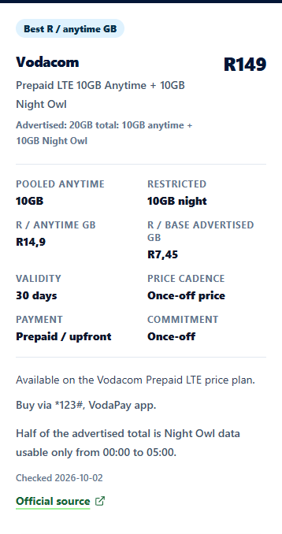

# DataCost comparison engine repair review

The live audit on 12 October 2026 found six empty tier comparisons. This branch repairs the shared selection and display mechanism, adds deployment gates, and preserves the distinction between anytime data and restricted wallets. It is prepared for review only; no production deployment is authorised or performed.

## Diagnosis

All seven tier routes returned HTTP 200 with comparison HTML already in the response. The six failures were not client rendering failures. The active route uses `ComparisonGuidePage`; the older `Cheapest10GB` component is not the active guide.

The page selected exact sizes from the small `bundles` catalogue, restricted candidates to once-off smartphone products, and rejected every bundle whose name mentioned night data or which had a night allocation. This incorrectly removed MTN's separately stated 5GB anytime allowance. Vodacom's 10GB, 20GB and 50GB entries were excluded by both product type and night allocation. The separate monthly tracker held broader evidence, but the tier table never consumed it. Several sizes simply lacked an exact smartphone record.

| Tier | Live source-checked rows before | Branch comparison rows after | Important limitation |
| --- | ---: | ---: | --- |
| 1GB | 3 | 3 | One operator has no exact recorded match; never infer market absence. |
| 2GB | 0 | 3 | Two newly checked 2GB split offers plus a recorded 3GB class alternative. Mixed 14- and 30-day validity; no like-for-like award. |
| 5GB | 0 | 2 | Both offers split anytime and night data; the LTE price plan has eligibility conditions. |
| 10GB | 0 | 10 | Includes advertised-total matches with less than 10GB anytime; those cannot win the pooled-anytime award. |
| 15GB | 0 | 1 | Recorded MTN Home Wi-Fi context only; no eligible pooled-anytime award or broad market claim. |
| 20GB | 0 | 11 | Restricted totals, daily-release wallets and longer validity are labelled; context rows do not win awards. |
| 50GB | 0 | 1 | Recorded Vodacom LTE context only; no eligible smartphone award or broad market claim. |

Counts are offer records, not unique providers. After counts are for the main tier comparison, excluding any separate exact-smartphone table. The live baseline is stored in `comparison-engine-live-baseline-2026-10-12.json`.

The shared audit also checks monthly, prepaid, WhatsApp and night guide modes. All four retained source-checked results. The main cheapest-data hub now uses the shared smartphone filter and tier summaries, avoiding a different night-bonus policy from the repaired guides.

## Comparison method

- The current monthly snapshot, additional recorded monthly operator bundles and explicitly checked supplemental offers form one comparison catalogue. Prices are read from the existing records rather than copied into page components. Equivalent offers are deduplicated. Historical snapshots are unchanged.
- The larger tiers reuse the monthly tracker's bands and award function. For example, the 10GB class covers 10GB to below 15GB of pooled anytime data or base advertised total. The 2GB display covers 2GB to below 5GB, with awards withheld because its evidence mixes validity periods.
- A restricted headline total can qualify for display without qualifying for an anytime award. Conditional bonuses and daily-release wallets remain outside pooled anytime data.
- LTE price-plan, bank account, SIM, recurring payment, commitment and purchase requirements remain visible. Existing tracker eligibility is preserved. Supplemental LTE/router records are conservatively context only.
- If a class disappears, larger alternatives are labelled and cannot receive a target-size award. If no current evidence supports any rows, the deployment check fails instead of accepting an empty comparison.
- Official source hosts, positive prices, nonnegative allocations, size mappings, check dates and a maximum 30-day evidence age are validated. Editorial dates do not replace price-check dates.

## Source-backed before and after example

Before, the live 10GB table showed four empty operator rows.

After, the branch shows Vodacom's recorded Prepaid LTE offer at R149 with **10GB anytime plus 10GB Night Owl**, 30-day validity, its qualifying price plan, purchase channels, night window and official source. R/anytime-GB is R14.90; R/base-advertised-GB is R7.45. The recorded check date remains 2 October 2026. The pricing and terms were also corroborated during this sprint; the stored historical snapshot was not rewritten.

Mobile review example:

The R99 offer is labelled **5GB anytime plus 5GB night**, not 10GB anytime. Its advertised total enters the 10GB class but its anytime allowance cannot win that class's pooled-anytime award. Neither example establishes a universal best offer for every user.

Official evidence checked during the sprint:

- [Vodacom prepaid plans](https://www.vodacom.co.za/vodacom/shopping/plans/prepaid-plans): 2GB+2GB at R49 for 14 days, 5GB+5GB at R99, 10GB+10GB at R149, 20GB+20GB at R229, and 50GB+50GB at R349, with the latter four valid for 30 days.
- [Vodacom LTE terms](https://www.vodacom.co.za/vodacom/terms/home-prepaid-lte): qualifying price plan, SIM exclusions, purchase channels and 00:00–05:00 Night Owl hours.
- [MTN Internet Bundles terms](https://www.mtn.co.za/home/terms-and-conditions/content/mtn-internet-bundles): monthly 2GB+2GB at R155 and 5GB+5GB at R299, 30-day validity, customer scope and purchase routes.
- [MTN Night Express terms](https://www.mtn.co.za/home/terms-and-conditions/content/mtn-night-express-data-bundles): a window of 00:01–04:59 conflicts with 23:59–05:00 in the general Internet Bundles document. The new MTN 2GB row exposes this conflict and advises confirmation instead of choosing a window silently.

Only the two supplemental 2GB records receive a new 12 October pricing check date. Other exposed records retain their existing source dates and restrictions. This is a mechanism repair, not an exhaustive new market-price audit.

## Search evidence and SEO changes

The managed handoff uses `site_id=datacost`, `sc-domain:datacost.co.za`, the DataCost repository and the 12 October completed collection for 7/28/90-day windows. All twelve referenced handoff files exist. The reporting request covers 13 September–10 October, with returned GSC daily observations through 9 October: 27 of 28 days. Direction and growth claims are therefore withheld.

| Tier | Returned page impressions | Returned page clicks |
| --- | ---: | ---: |
| 1GB | 1,622 | 27 |
| 2GB | 249 | 2 |
| 5GB | 304 | 4 |
| 10GB | 95 | 1 |
| 15GB | 63 | 0 |
| 20GB | 325 | 2 |
| 50GB | 116 | 0 |

These are page-level observations, not impressions for one specific query. `comparison-engine-gsc-baseline-2026-10-12.json` records the source manifest, collection dates and returned page metrics. An improvement in usefulness is demonstrated by the rendered content; search impact remains unmeasured until an approved deployment and sufficient observations.

The branch retains canonical routes, provides comparison content in built HTML, aligns ItemList entries with displayed source-checked offers, and adds links between allowance tiers, the real monthly tracker and methodology. No speculative availability, ratings or rich-result guarantees are added. This follows [Google's structured-data content requirements](https://developers.google.com/search/docs/appearance/structured-data/sd-policies).

## Deployment checks and review limitations

`npm run build` now runs comparison regressions and catalogue validation before bundling, then verifies every guide's HTML and schema after prerendering. The browser gate checks all seven tiers at 390, 768 and 1440 pixels without JavaScript, compares mobile/desktop prices and source links with schema, checks enlarged comparison text and keyboard focus, and verifies hydration on the 10GB page. These gates run in the existing pull-request/build workflow before a deploy artifact can be uploaded.

Focused regression coverage includes split-wallet rejection, misleading total-size matches, catalogue deduplication, context-only awards, mixed-validity 2GB offers, fallback labels, stale/future/unverified evidence, schema parity and consent-respecting 2GB source-click tracking. The clean-install failure from locked `tsx` 4.23.0 was reproduced; upgrading the lock to 4.23.15 restored the existing React-render tests without modifying production Helmet imports.

Validation completed: TypeScript lint, seven comparison regressions, nineteen monthly/MVNO/analytics tests, 120 WP1 contract tests, existing editorial integrity checks, production build, SEO checks across 251 HTML pages and five sitemap files, AdSense checks, and the comparison browser gate. An injected missing mobile offer was also confirmed to fail the output gate; the built file was restored byte-for-byte. Screenshots and browser receipts are in `.codex-temp/comparison-review`.

Known limitation: at 200% root text size on a 390px viewport, the unchanged site header expands the page to 488px. The comparison content itself stays within the viewport. Header repair is outside this sprint; no site-wide accessibility conformance claim is made. No field performance, indexing or post-deployment traffic outcome has been verified.

The review boundary is a local branch and commit. No push, merge, publication, indexing submission or production deployment is performed.
